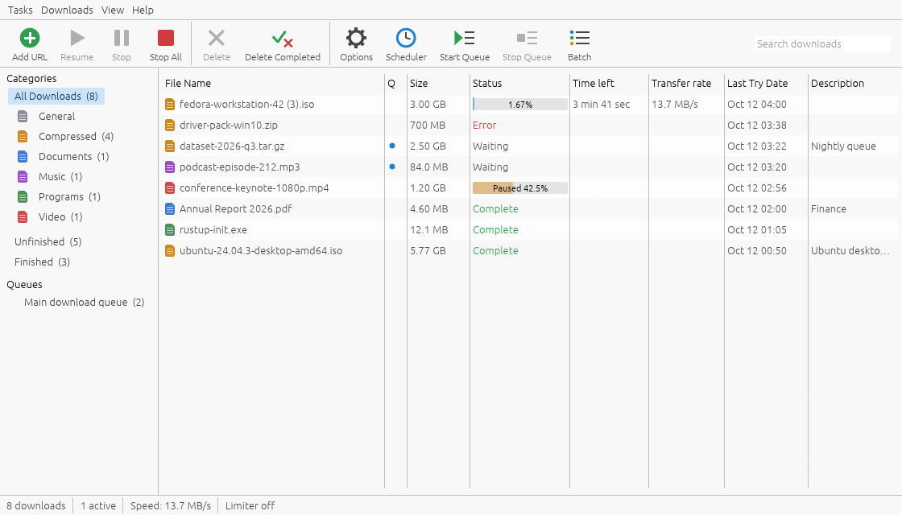
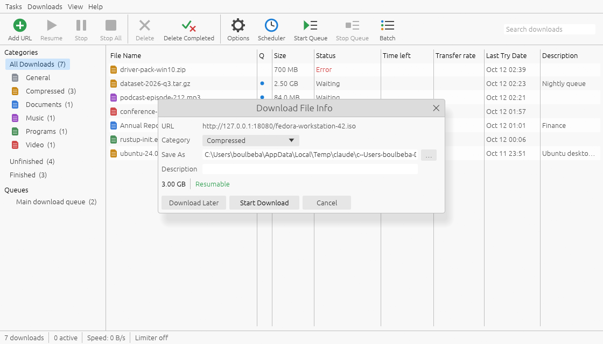
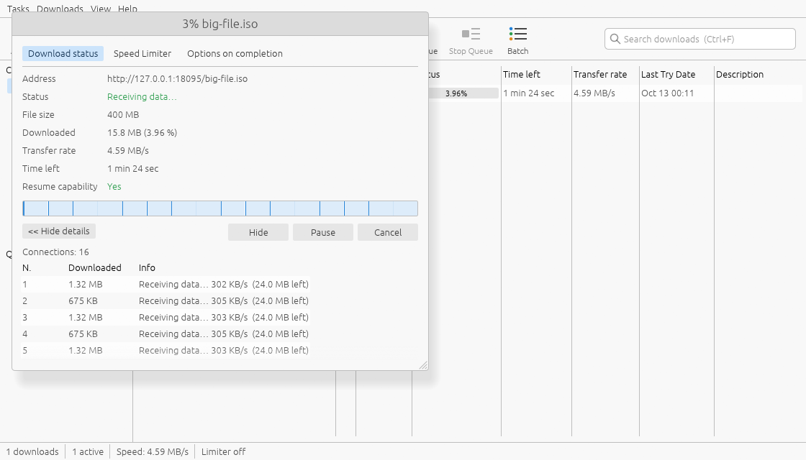
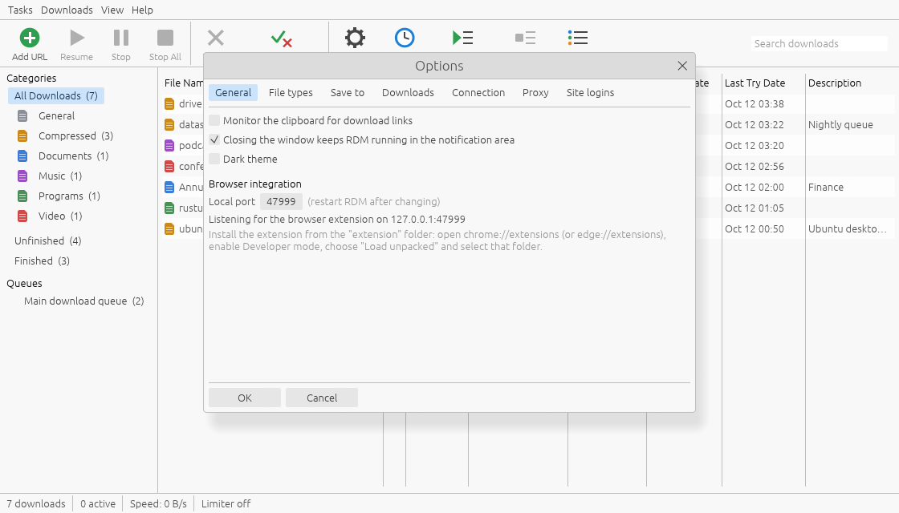
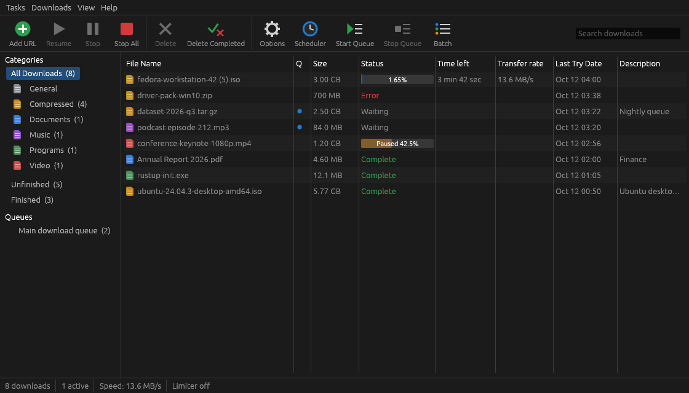
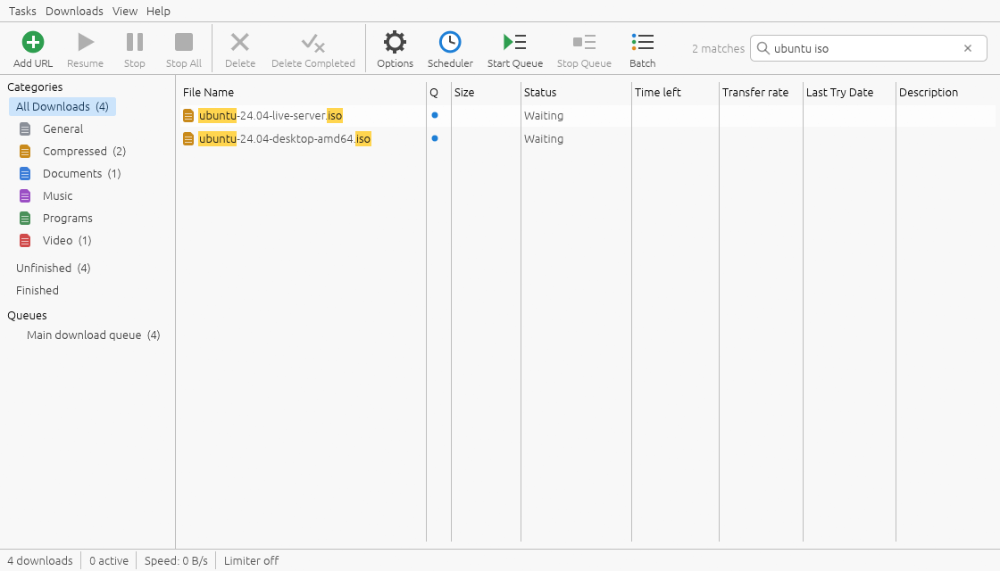
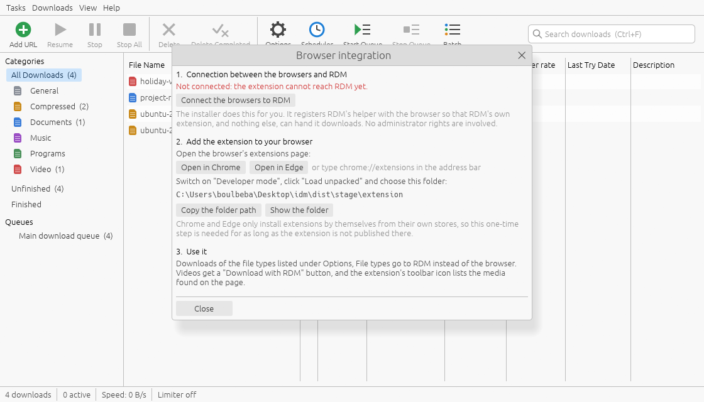

<div align="center">


# Rapid Download Manager

**A fast, open-source download accelerator for Windows, written in Rust.**

Splits every file across up to 32 connections, resumes after anything short of a
dead disk, and stays out of your way.

[](https://github.com/boulbeba115/Rapid-Download-Manager-RDM-/releases/latest)
[](https://github.com/boulbeba115/Rapid-Download-Manager-RDM-/releases)


[](LICENSE)

[**Download**](#download) · [Features](#features) · [How it gets its speed](#how-it-gets-its-speed) · [Usage](#usage) · [Build from source](#build-from-source)

<br>



</div>

---

## Download

| | File | For |
|---|---|---|
| **Installer** | [`RDM-x.y.z-Setup.exe`](https://github.com/boulbeba115/Rapid-Download-Manager-RDM-/releases/latest) | Most people. Installs for your user only — **no administrator rights needed** — with Start-menu entry and a clean uninstaller. |
| **Portable** | [`RDM-x.y.z-portable-win64.zip`](https://github.com/boulbeba115/Rapid-Download-Manager-RDM-/releases/latest) | Unzip anywhere (a USB stick is fine). Settings stay in a `data` folder next to the program. |

Requires 64-bit Windows 10 or 11. Nothing else to install: one ~10 MB executable, no runtime.

> **First-run notice.** Unless a release says otherwise, the builds are not signed
> with a certificate Windows trusts, so the publisher shows as *unknown* and
> SmartScreen may show *"Windows protected your PC"*. Choose **More info → Run
> anyway**, or verify the file against `SHA256SUMS.txt` on the release page first.
> The build scripts can sign everything; what is missing is the certificate — see
> [Signing](#signing).

## Features

**Speed**
- Dynamic file segmentation over **1–32 connections**, with idle connections taking work from busy ones
- **Auto** mode starts at 8 connections and keeps adding while it measurably helps
- Reuses the very first response instead of throwing it away, and reuses connections between segments
- Replaces a connection that is crawling far below the others

**Reliability**
- **Pause and resume** — including after a crash, power cut or reboot
- Detects a file that changed on the server and never splices old and new data together
- Automatic retry with back-off; honours `429` / `Retry-After` and adapts to per-site connection limits instead of hammering them
- Optional **MD5 / SHA-1 / SHA-256** verification

**Everyday use**
- Categories with their own folders (Compressed, Documents, Music, Programs, Video)
- **Queues** (run N files at a time) and a **scheduler** (start/stop times, weekdays, shut down when done)
- Global and per-download **speed limits**
- **Browser integration** for Chrome, Edge and Brave: downloads go to RDM instead of the browser (never both), with cookies and referrer; RDM is started if it is not running
- A **Download with RDM button on videos**, and a list of the media found on the page
- **Video streams**: paste an HLS (`.m3u8`) link and get one joined file, AES-128 handled
- **Link grabber**: list and pick the files a web page links to
- Batch downloads (`file*.zip`, 1–100), clipboard monitoring, drag & drop of link lists, import / export
- **Search** that matches every word against name, address, description, category and status (`Ctrl+F`)
- Notification-area icon (the main window and each progress window can be hidden there), start with Windows, dark theme
- Proxy support (HTTP, HTTPS, SOCKS5), site logins, per-site connection limits
- IDM-compatible command line, plus `rdmc` for scripts and terminals

## How it gets its speed

Most servers cap each connection, not each visitor. RDM asks for the file in
several ranges at once and — the important part — keeps every connection busy
until the last byte:

1. **No wasted first request.** The request that finds out the file's size is a
   real download request; its response becomes the first segment's data.
2. **Work stealing.** When a connection finishes its part, it takes the back half
   of whichever remaining part will take the *longest* (measured by speed, not
   just size). Nothing sits idle while another connection still has work.
3. **Straight to its final place.** Data is written at its final offset in one
   pre-sized file. Finishing is a rename, not a second pass that merges parts.
4. **Polite under pressure.** If a server refuses extra connections, RDM learns
   the limit from the first refusal, waits as long as the server asks, and lets
   the connections that *were* accepted carry on through the rest of the file.

Measured on a release build (every result verified byte-for-byte):

| Scenario | 1 connection | RDM | |
|---|---|---|---|
| Server capped at 2 MB/s per connection, 16 connections | 2.0 MB/s | **31.4 MB/s** | 15.7× |
| Same server, Auto mode | 2.0 MB/s | 23.1 MB/s | 11.6× |
| Loopback, no cap (includes writing to disk) | 0.87 GB/s | 0.96 GB/s | disk-bound |

On a line that one connection already fills, more connections cannot add speed —
RDM then simply matches it. No side-by-side measurement against other download
managers has been made.

## Screenshots

| Download File Info | Progress and segment map |
|---|---|
|  |  |
| **Options** | **Dark theme** |
|  |  |
| **Search** | **Browser integration** |
|  |  |

## Usage

### Start a download

Click **Add URL**, paste the address, press **OK**. RDM asks the server about
the file, suggests a category and folder, and waits for **Start Download** or
**Download Later** (which puts it in the main queue). Copying a link and pressing
`Ctrl+V` in the window does the same.

### Browser integration (Chrome, Edge, Brave)

Two things have to be in place. The installer does the first; the second is a
one-time step in the browser. *Help → Browser integration* in RDM shows both,
with buttons for each step.

1. **The browser must know where RDM is.** The installer registers RDM's helper
   (`rdm-host.exe`) for Chrome, Edge, Brave and Chromium. A portable copy does
   it from *Help → Browser integration → Connect the browsers to RDM*.
2. **The extension must be added to the browser.** Open `chrome://extensions`
   or `edge://extensions`, switch on **Developer mode**, choose **Load unpacked**
   and select the `extension` folder next to `rdm.exe`.

   Chrome and Edge on Windows only install an extension *without* this step when
   it comes from their own store. The extension is not published there yet; once
   it is, set its store IDs in `crates/rdm-core/src/browser.rs` and the installer
   will make the browser offer it by itself.

What you get:

- Downloads of the file types listed under *Options → File types* go to RDM.
  The browser's own download is cancelled only after RDM has accepted the file,
  so it is never downloaded twice, and never lost if RDM cannot take it.
- RDM does not have to be running: it is started when a download needs it.
- A **Download with RDM** button appears on videos (move the pointer over the
  video). One click sends the best version; the small arrow next to it lists
  the others. The extension's toolbar icon lists the video, audio and HLS
  streams the page has loaded. Right-click a link or video → **Download with RDM**.
- The button's clicks never reach the page. Video sites hang "open an advert in
  a new tab" on every click and lay invisible layers over their players; the
  button sits above those and takes its clicks before the page sees them.
- **Facebook** videos (including reels) are offered as whole files with sound,
  in HD and SD. Facebook's player gets its video in pieces from script, so the
  extension reads the file addresses from the data Facebook loads for the page,
  and uses the video's length to pick the right one when a page holds several.
- Every download offered by the browser opens RDM's *Download File Info* dialog
  first; nothing starts until you confirm it there.

Not supported:

- **YouTube.** There is no file address to hand over: the picture and the
  sound come as separate streams, and their addresses are scrambled by player
  code that YouTube changes frequently and are tied to a per-session token.
  Tools that manage it (such as yt-dlp) are dedicated extractors that are
  updated every few weeks, and they need ffmpeg to join picture and sound.
  YouTube's terms also forbid downloading, and the Chrome Web Store rejects
  extensions that do it — which matters for getting the extension published.
- DRM-protected video, and other sites that feed their player from script
  without an HLS playlist (each needs its own rule, as Facebook has).
- DASH (`.mpd`) streams.

### Security

- **Only RDM's own extension can reach RDM.** The extension uses the browser's
  native messaging: the browser itself starts `rdm-host.exe` and only for the
  extension IDs listed in the host's manifest. Web pages and other extensions
  have no way in.
- **The local port is closed to browsers.** RDM listens on `127.0.0.1` for its
  own helper programs only. Every request must carry a secret that is created
  anew on each start and readable only by your Windows account; requests that
  carry a browser `Origin`, or a `Host` other than the loopback address, are
  refused even with it.
- **The browser cannot choose where a file lands** or skip the confirmation
  dialog; a request from the browser is reduced to the address, referrer,
  cookies, user agent and a sanitised file name.
- **The page button cannot be driven by the page.** It lives in a closed shadow
  tree and reacts to real clicks only.
- **On Facebook, one small script runs in the page's own world** to read video
  addresses out of the data the page loads. It has none of the extension's
  privileges and sends nothing anywhere; every address it reports is checked
  again (it must be on Facebook's video servers) before it is offered.
- **Finished files carry the mark of the web**, like files saved by a browser,
  so SmartScreen and Office Protected View still apply to them.
- **Cookies and passwords stay with their site.** They are not sent along when a
  redirect or a stream playlist points at another site, and never over plain
  HTTP if they were given for HTTPS.
- **Saved passwords and cookies are encrypted** in the settings files with
  Windows data protection (tied to your account). A portable copy stores them as
  plain text instead, so its folder keeps working on another computer.
- The extension has no remote code, a strict content-security policy, and makes
  no network requests of its own.

### Video streams

Paste the address of an HLS playlist (`.m3u8`). RDM picks the best quality,
downloads the segments in parallel and joins them into one `.ts` (or `.mp4`)
file. Live streams and DRM-protected streams are not supported.

### Command line

```powershell
rdm.exe https://example.com/file.zip           # opens the Download File Info dialog
rdm.exe /d <url> /p D:\Downloads /f name.zip   # the same, with folder and name
rdm.exe /n /d <url>                            # start without asking
rdm.exe /n /q /d <url>                         # …and exit when it has finished
rdm.exe /a /d <url>                            # add to the main queue, do not start
rdm.exe /s                                     # start the main queue
rdm.exe --minimized                            # start in the notification area
rdm.exe --browser-setup                        # open the browser integration guide
```

If RDM is already running, these are handed to the running window.

`rdmc` is the same engine without a window:

```powershell
rdmc get <url>                      # Auto connections; run again to resume
rdmc get <url> -c 8 -l 2M -o D:\x   # 8 connections, 2 MB/s limit, save to D:\x
rdmc get <url> -v                   # show what the engine decides and why
rdmc bench -s 256M -r 2M -c 16      # 1 vs 16 connections against a throttled local server
```

### Where things are stored

| | Installed | Portable |
|---|---|---|
| Settings, download list, `rdm.log` | `%APPDATA%\RDM` | `data\` next to `rdm.exe` |
| Downloads | your *Downloads* folder, one sub-folder per category (changeable in *Options → Save to*) | same |

## Build from source

```powershell
git clone https://github.com/boulbeba115/Rapid-Download-Manager-RDM-.git
cd Rapid-Download-Manager-RDM-
cargo build --release
.\target\release\rdm.exe
```

Any recent stable Rust works with the MSVC or a full MinGW-w64 toolchain.

<details>
<summary><b>Building with the bare <code>x86_64-pc-windows-gnu</code> toolchain (no Visual Studio, no MinGW)</b></summary>

<br>

That is how this project is developed. The bare toolchain needs two settings in
the user-level `%USERPROFILE%\.cargo\config.toml`:

```toml
[target.x86_64-pc-windows-gnu]
rustflags = ["-C", "dlltool=C:/Users/<you>/.cargo/tools/llvm-dlltool.exe",
             "-C", "linker-flavor=ld.lld", "-C", "linker=rust-lld"]
```

- `llvm-dlltool.exe` is a copy of `llvm-ar.exe` from `rustup component add llvm-tools`
  (a multi-call binary). The bundled GNU `dlltool` needs an assembler rustup does not ship.
- Linking must use Rust's bundled LLD. GNU `ld` mis-links LLVM-style import
  libraries; the resulting programs crash at start-up.

For the same reason no dependency may need a C compiler, and the icon and
version information are written into the finished executables by `crates/xtask`
rather than by a resource compiler.

</details>

### Tests

```powershell
cargo test --workspace             # 100 tests
.\scripts\package.ps1              # build the installer and the portable zip into dist\
.\scripts\test-installer.ps1       # install, run, uninstall — 63 checks (71 for a signed build)
.\scripts\test-integration.ps1     # clipboard monitoring + the extension in a real Edge — 40 checks
```

The Rust tests run the engine against a local HTTP server that misbehaves on
purpose (throttling, connection caps, rate limits, dropped connections, changed
files, missing range support, an authenticating proxy), download HLS streams
with encrypted segments, and click through the real interface with
[egui_kittest](https://crates.io/crates/egui_kittest).

The two scripts are safe to run on a computer where RDM is installed and
running: they use their own profile and port, and put back the registry entries
and shortcuts of the real installation. The browser test drives a real Edge
with a throwaway profile: a page starts downloads and shows a video, and the
script checks what reached RDM and what the browser kept. That page behaves like
an advert-laden video site on purpose (it grabs every click and covers its
player), and serves page data in Facebook's format.

### Packaging

`scripts\package.ps1` needs [NSIS 3](https://nsis.sourceforge.io) — either on
`PATH`, or unzipped under `tools\`.

### Signing

Windows shows a publisher name instead of *Unknown publisher*, and SmartScreen
builds up trust in a download, only for files signed with a code-signing
certificate **issued by a certificate authority Windows trusts**. No script can
create that trust: the certificate has to be obtained (the issuer verifies who
you are). Common routes:

- [SignPath Foundation](https://signpath.org) — free for open-source projects
- Microsoft's [Trusted Signing](https://learn.microsoft.com/azure/trusted-signing/) — a monthly subscription, where available
- an OV or EV certificate from a certificate authority such as Certum, Sectigo or DigiCert

Once the certificate is in the Windows certificate store (which is also where a
USB token or cloud key shows up), signing is one switch:

```powershell
$env:RDM_SIGN_THUMBPRINT = "<thumbprint of the certificate>"
.\scripts\package.ps1 -Sign
```

This signs `rdm.exe`, `rdmc.exe` and `rdm-host.exe`, the uninstaller inside the
installer, and the installer itself, all SHA-256 and time-stamped, and fails the
build if any signature cannot be made. `scripts\test-installer.ps1` then checks
the signatures of what was actually installed. A `.pfx` file can be used instead
(`RDM_SIGN_PFX`, `RDM_SIGN_PFX_PASSWORD`); see `scripts\sign.ps1`.

To try the signed build without a real certificate,
`scripts\new-test-certificate.ps1` creates a self-signed one. It changes nothing
for anyone else: other computers still see an unknown publisher.

A new certificate starts with no SmartScreen reputation: the publisher name
appears at once, the SmartScreen warning fades as more people download the
signed file.

### Project layout

| Path | What |
|---|---|
| [`crates/rdm-core`](crates/rdm-core) | The engine: segmentation, resume, HLS, queues, scheduler, the local API. No GUI code. |
| [`crates/rdm-app`](crates/rdm-app) | The desktop application ([egui](https://github.com/emilk/egui)). |
| [`crates/rdm-cli`](crates/rdm-cli) | `rdmc`: terminal downloader, benchmark, test server. |
| [`crates/rdm-host`](crates/rdm-host) | `rdm-host`: the native-messaging host the browser starts for the extension. |
| [`crates/xtask`](crates/xtask) | Build helper: icon generation, stamping executables. |
| [`extension`](extension) | Browser extension (Manifest V3): download capture, the button on videos, the popup. |
| [`installer`](installer) | NSIS installer script. |
| [`SPEC.md`](SPEC.md) | Design, and an exact account of what is implemented and how it was verified. |

## Status and roadmap

Version 0.2 is an early release. It is tested as described above, but it has not
had many real-world users yet — please [open an issue](https://github.com/boulbeba115/Rapid-Download-Manager-RDM-/issues)
when something misbehaves, ideally with the relevant lines from `rdm.log`.

Not there yet:

- FTP downloads
- DASH (`.mpd`) streams
- Multi-level site grabbing (the link grabber works on one page)
- Store listings of the extension for Chrome / Edge (until then it is added by hand, see above), and a Firefox version
- A certificate for code signing (the signing itself is built in, see [Signing](#signing))
- Remembering a site's connection limit between sessions (set it by hand under *Options → Connection* for now)

## License

[MIT](LICENSE).

Rapid Download Manager is an independent project. It is not affiliated with,
and contains no code or artwork from, Internet Download Manager or Tonec Inc.
